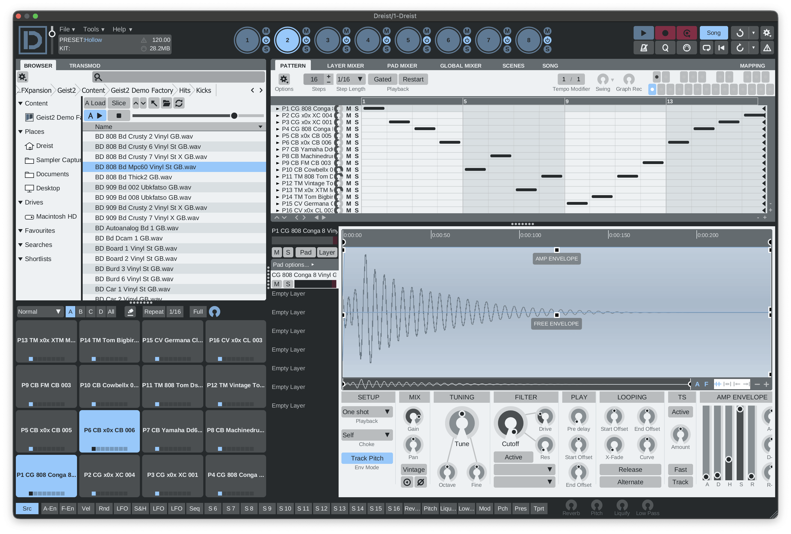
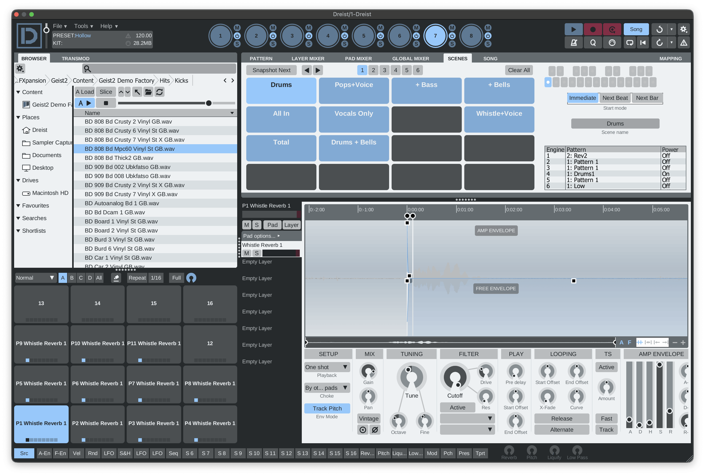
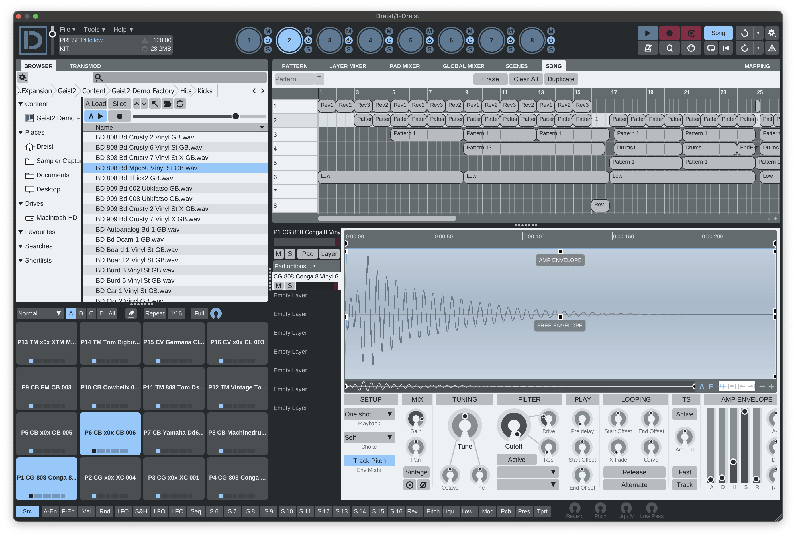
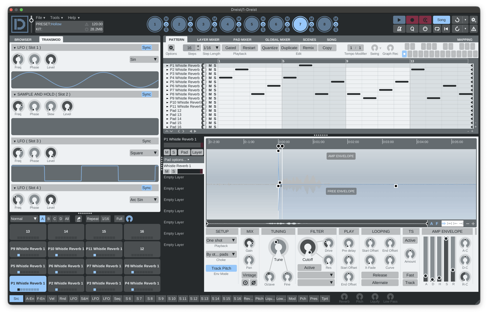

<div align="center">

# Dreist

[](https://github.com/koeves/dreist/releases/latest)
[](https://github.com/koeves/dreist/actions/workflows/release.yml)
[](https://github.com/koeves/dreist/actions/workflows/ci.yml)
[](https://github.com/koeves/dreist/actions/workflows/codeql.yml)
[](LICENSE)
[](#installation)
[](#installation)

</div>

Dreist is a drum sampler, step sequencer and performance instrument: a Rust rebuild of FXpansion
**Geist2** 2.1.2.13.

| | |
|---|---|
|  |  |
|  |  |

## Highlights

- **Instrument**: pads, layers, patterns, scenes, song mode and 47 effects.
- **Opens**: Geist2 `.geist` projects, kits and patterns.
- **Saves**: its own `.dreist` family (`.dreist`, `.dreistkit`, ...) in Geist2's XML.
- **Runs as**: VST3, CLAP and a standalone app on macOS, Windows and Linux.

## Contents

- [Installation](#installation)
- [Content](#content)
- [Building](#building)
- [Layout](#layout)
- [Contributing](#contributing)
- [Related projects](#related-projects)
- [Licence](#licence)

## Installation

Download the archives for your system from the [latest release](https://github.com/koeves/dreist/releases/latest).

| System | Requirements | VST3 | CLAP | App |
|---|---|---|---|---|
| macOS | 11+, Apple Silicon | `Dreist-<tag>-macOS-VST3.zip` | `Dreist-<tag>-macOS-CLAP.zip` | `Dreist-<tag>-macOS-App.zip` |
| Windows | 10+, x64 | `Dreist-<tag>-Windows-VST3.zip` | `Dreist-<tag>-Windows-CLAP.zip` | `Dreist-<tag>-Windows-App.zip` |
| Linux | x86_64, glibc 2.39+, X11 or XWayland | `Dreist-<tag>-Linux-VST3.tar.gz` | `Dreist-<tag>-Linux-CLAP.tar.gz` | `Dreist-<tag>-Linux-App.tar.gz` |

### macOS

- **VST3**: move `Dreist.vst3` to `~/Library/Audio/Plug-Ins/VST3/`.
- **CLAP**: move `Dreist.clap` to `~/Library/Audio/Plug-Ins/CLAP/`.
- **App**: move `Dreist.app` to `/Applications`.
- **First launch**: the builds are unsigned, so open the app with right-click › Open › Open.
- **Plugins blocked by a host**: clear the quarantine flag.

```bash
xattr -dr com.apple.quarantine ~/Library/Audio/Plug-Ins/VST3/Dreist.vst3 ~/Library/Audio/Plug-Ins/CLAP/Dreist.clap
```

### Windows

- **VST3**: move the `Dreist.vst3` folder to `C:\Program Files\Common Files\VST3\`.
- **CLAP**: move the `Dreist` folder (`Dreist.clap` and `Resources`) to `C:\Program Files\Common Files\CLAP\`.
- **App**: unzip the `Dreist` folder anywhere and run `Dreist.exe`; keep `Resources` next to it.
- **First launch**: the builds are unsigned; if SmartScreen warns, choose More info › Run anyway.

### Linux

- **VST3**: move `Dreist.vst3` to `~/.vst3/` (or `/usr/lib/vst3/`).
- **CLAP**: move the `Dreist` folder (`Dreist.clap` and `Resources`) to `~/.clap/` (or `/usr/lib/clap/`).
- **App**: unpack the `Dreist` folder anywhere (say `~/.local/share/Dreist`) and run `Dreist`; keep `Resources` next to it.
- **Launcher**: `dreist.desktop` goes in `~/.local/share/applications`, `dreist.png` in `~/.local/share/icons/hicolor/256x256/apps`.
- **Runtime**: ALSA, X11 / XCB and OpenGL, present on desktop systems.
- **File dialogs**: through the XDG desktop portal, or `zenity` without one.

### Settings

- **macOS**: `~/Library/Application Support/Dreist`.
- **Windows**: `%APPDATA%\Dreist`.
- **Linux**: `~/.config/Dreist` (or `$XDG_CONFIG_HOME/Dreist`).

### Limitations

- **REX files** (`.rx2`, `.rex`) load on macOS only.
- **Dragging samples** out of Dreist into a host or file manager works on macOS only.
- **Wayland** desktops run Dreist through XWayland.

## Content

- **Samples**: none included; get Geist2 content (such as the starter pack) from FXpansion.
- **Loads as is**: Geist2 kits, presets and expansions.
- **Location**: `~/Documents/FXpansion/Geist2` (Windows: `%USERPROFILE%\Documents\FXpansion\Geist2`); change it under Preferences.
- **Bundled**: Geist2's factory effect presets, chains and pattern templates.

## Building

Needs a Rust toolchain.

```bash
git clone --recursive https://github.com/koeves/dreist
scripts/build.sh                  # macOS: target/bundled/Dreist.{app,vst3,clap}
scripts/build.sh --install        # macOS: also into ~/Library/Audio/Plug-Ins and /Applications
scripts/build-windows.sh          # Windows, in Git Bash
scripts/build-linux.sh            # Linux
scripts/build-linux.sh --install  # Linux: also into ~/.vst3, ~/.clap and ~/.local
cargo test --workspace
```

Linux build packages (Debian / Ubuntu names):

```bash
sudo apt-get install pkg-config libasound2-dev libx11-dev libx11-xcb-dev libxcb1-dev libxcursor-dev libgl1-mesa-dev
```

## Layout

Dreist is an app on [dreist-commons](https://github.com/koeves/dreist-commons), which holds the formats, DSP, engine and GUI crates.

| Crate | Role |
|---|---|
| `dreist-editor` | Panels, dialogs, settings, effect menu and document readers |
| `dreist-plugin` | VST3, CLAP and standalone (nih-plug), and Dreist's app profile |
| `dreist-cli` | `dreist-inspect` (summarise a project, check its samples), render and comparison tools |
| `xtask` | Bundler |

- `assets/ui`: the UI, generated by `scripts/uigen/uigen.py` ([details](assets/ui/README.md)).
- `assets/factory`: Geist2's factory presets, chains and templates.

## Contributing

- Commits, checks, branches and releases: [CONTRIBUTING.md](CONTRIBUTING.md).

## Related projects

- [dreist-commons](https://github.com/koeves/dreist-commons): the shared formats, DSP, engine and GUI crates.
- [Einst](https://github.com/koeves/einst): the Geist v1 rebuild on the same crates.

## Licence

- **Crates**: MIT OR Apache-2.0.
- **`dreist-plugin` and the binaries built from it**: GPL-3.0-or-later.
- **Details**: [LICENSE](LICENSE) and [THIRD_PARTY_NOTICES.md](THIRD_PARTY_NOTICES.md).
- Dreist is not affiliated with or endorsed by FXpansion.
