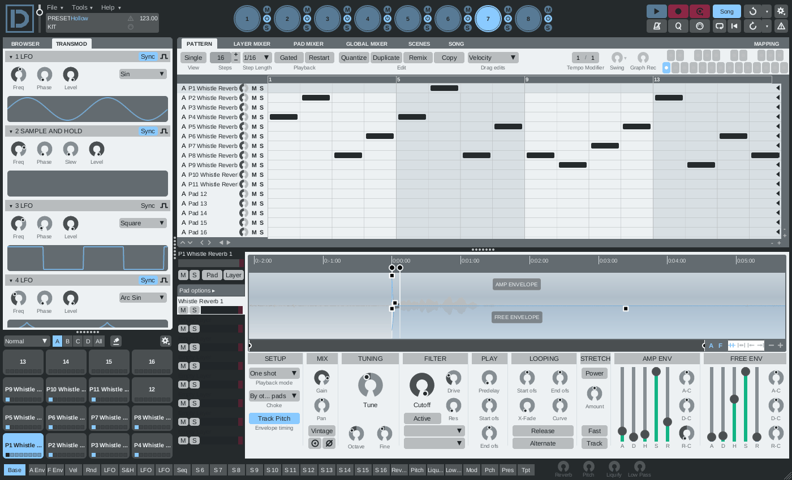

# Dreist

A drum sampler, step sequencer and performance instrument (pads, layers, song
mode, 47 effects), rebuilt in Rust from the reverse-engineered behaviour of
FXpansion **Geist2** 2.1.2.13. It loads Geist2 `.geist` projects, kits and
patterns. Builds as VST3, CLAP and a standalone app for macOS (Apple Silicon)
and Windows (x64).



## Installing the beta

Download the zips for your system from the
[releases page](https://github.com/koeves/dreist/releases): `Dreist-<version>-<os>-VST3.zip`,
`-CLAP.zip` and `-App.zip`.

**macOS**

- VST3: unzip and move `Dreist.vst3` to `~/Library/Audio/Plug-Ins/VST3/`.
- CLAP: move `Dreist.clap` to `~/Library/Audio/Plug-Ins/CLAP/`.
- App: move `Dreist.app` to `/Applications` (or `~/Applications`).

The beta builds are not signed or notarised. Open the app the first time with
right-click (or Control-click) › Open › Open. If a host refuses to load the
plugins, clear the quarantine flag:

```bash
xattr -dr com.apple.quarantine ~/Library/Audio/Plug-Ins/VST3/Dreist.vst3 ~/Library/Audio/Plug-Ins/CLAP/Dreist.clap
```

**Windows**

- VST3: unzip and move the `Dreist.vst3` folder to `C:\Program Files\Common Files\VST3\`.
- CLAP: move the `Dreist` folder (holding `Dreist.clap` and its `Resources`) to
  `C:\Program Files\Common Files\CLAP\`.
- App: unzip the `Dreist` folder anywhere and run `Dreist.exe`. Keep the
  `Resources` folder next to it. SmartScreen may warn on first launch, because
  the build is unsigned: More info › Run anyway.

**Content**

Dreist does not include sample content. Get Geist2 content (such as the
starter pack) from FXpansion; Geist2 kits, presets and expansions load as they are. Dreist looks in
`~/Documents/FXpansion/Geist2` (Windows: `%USERPROFILE%\Documents\FXpansion\Geist2`);
change the location under Preferences.

## Build

Needs a Rust toolchain.

```bash
scripts/build.sh            # macOS: target/bundled/Dreist.{app,vst3,clap}
scripts/build.sh --install  # also copies them to ~/Library and ~/Applications
scripts/build-windows.sh    # Windows (Git Bash): target/bundled/Dreist.vst3, Dreist-CLAP/, Dreist-App/
cargo test --workspace
```

Contributor and coding-agent notes: [`.agents/`](.agents/README.md).

Publishing a GitHub release runs `.github/workflows/release.yml`. It tests and
builds on macOS and Windows and attaches the zips to the release.

## Layout

| Crate | Role |
|---|---|
| `dreist-formats` | project / kit / pattern file formats |
| `dreist-dsp` | voices, filters, effects |
| `dreist-engine` | sequencer, mixer, modulation, song, sampler |
| `dreist-gui` | skin-driven UI toolkit (baseview + tiny-skia) |
| `dreist-editor` | the editor panels |
| `dreist-plugin` | nih-plug VST3 / CLAP / standalone |
| `dreist-cli` | `dreist-inspect`: summarise a Geist2 file, check its samples |
| `dreist-testkit` | test helpers (golden fingerprints, signal checks) |

The UI (skins, stylesheets, icon font, cursors, metronome sounds) is Dreist's
own, generated by `scripts/uigen/uigen.py` into `assets/ui`.
`assets/factory` holds Geist2's factory effect presets, effect chains and
pattern / swing templates (FXpansion's files), which are bundled with the
builds.

## Licence

The crates are MIT OR Apache-2.0. `dreist-plugin` and the binaries built from
it are GPL-3.0-or-later. See [`LICENSE`](LICENSE) and
[`THIRD_PARTY_NOTICES.md`](THIRD_PARTY_NOTICES.md). Dreist is not affiliated
with or endorsed by FXpansion.
