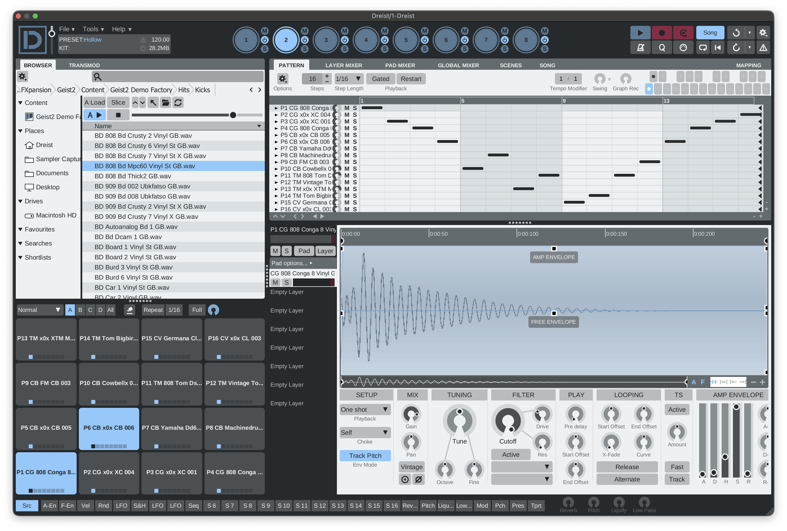
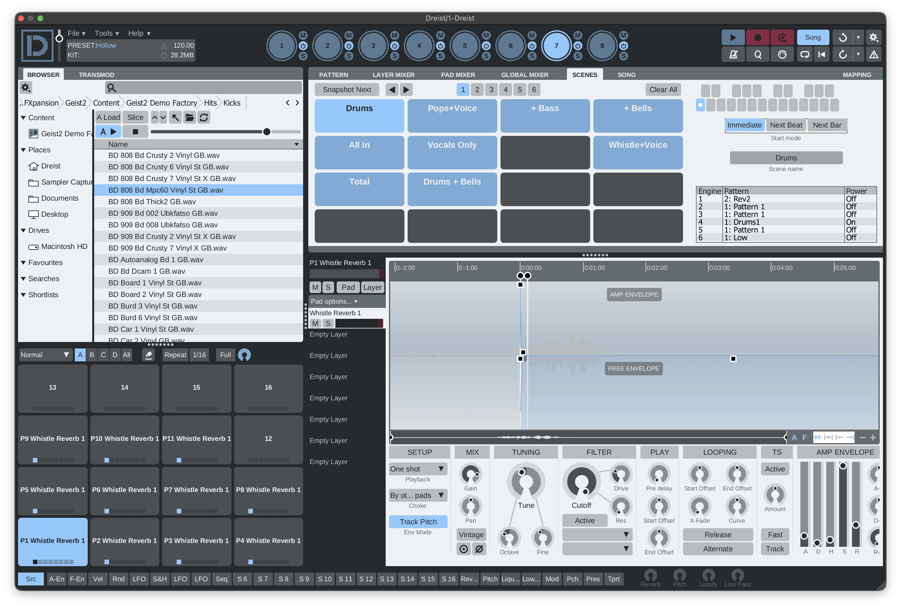
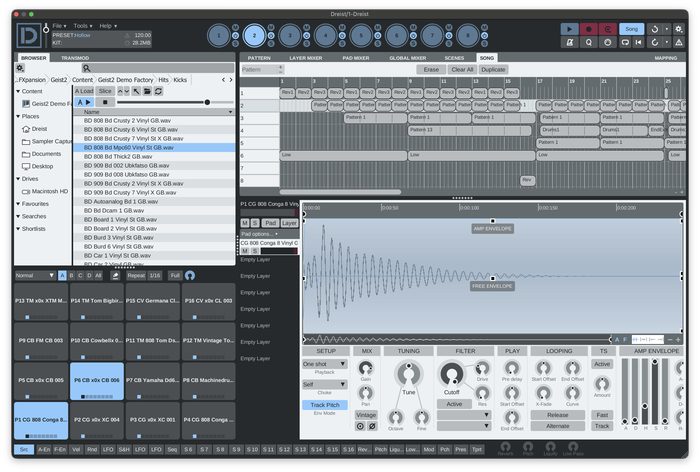
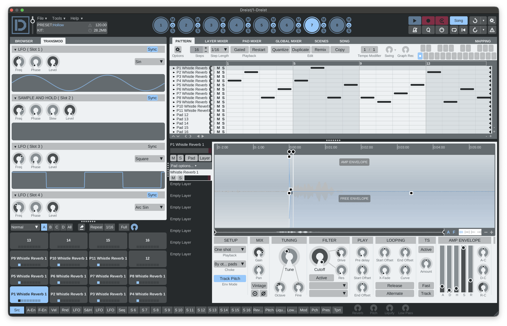

<div align="center">

# Dreist

[](https://github.com/koeves/dreist/releases/latest)
[](https://github.com/koeves/dreist/actions/workflows/release.yml)
[](https://github.com/koeves/dreist/actions/workflows/ci.yml)
[](https://github.com/koeves/dreist/actions/workflows/codeql.yml)
[](LICENSE)
[](#installation)
[](#installation)

</div>

Dreist is a drum sampler, step sequencer and performance instrument: a Rust rebuild of FXpansion
**Geist2** 2.1.2.13.

| | |
|---|---|
|  |  |
|  |  |

## Highlights

- **Instrument**: pads, layers, patterns, scenes, song mode and 47 effects.
- **Opens**: Geist2 `.geist` projects, kits and patterns.
- **Saves**: its own `.dreist` family (`.dreist`, `.dreistkit`, ...) in Geist2's XML.
- **Runs as**: VST3, CLAP and a standalone app on macOS, Windows and Linux.

## Contents

- [Installation](#installation)
- [Content](#content)
- [Building](#building)
- [Layout](#layout)
- [Contributing](#contributing)
- [Related projects](#related-projects)
- [Licence](#licence)

## Installation

Download the archive for your system from the [latest release](https://github.com/koeves/dreist/releases/latest), unpack it and run its install script.

| System | Requirements | Archive | Install | Uninstall |
|---|---|---|---|---|
| macOS | 11+, Apple Silicon | `Dreist-<tag>-macOS.zip` | `./install.sh` | `./install.sh --uninstall` |
| Windows | 10+, x64 | `Dreist-<tag>-Windows.zip` | `.\install.ps1` | `.\install.ps1 --uninstall` |
| Linux | x86_64, glibc 2.39+, X11 or XWayland | `Dreist-<tag>-Linux.tar.gz` | `./install.sh` | `./install.sh --uninstall` |

- **What it installs**: the app, VST3 and CLAP in the standard folders, for your user on macOS and Linux and for all users on Windows ([locations](https://github.com/koeves/dreist-commons/blob/dev/packaging/README.md#locations)).
- **All users on macOS and Linux**: add `--system` and run it with `sudo`.
- **Windows**: run it in an administrator PowerShell, or add `--user` to install for your user only.
- **Settings and content** stay on uninstall.
- **Single parts**: the release also has one archive each for the VST3, CLAP and app, to place by hand.

### macOS

- **First launch**: the builds are unsigned, so open the app with right-click › Open › Open.
- **Plugins blocked by a host**: clear the quarantine flag.

```bash
xattr -dr com.apple.quarantine ~/Library/Audio/Plug-Ins/VST3/Dreist.vst3 ~/Library/Audio/Plug-Ins/CLAP/Dreist.clap
```

### Windows

- **Running the script**: in PowerShell, `powershell -ExecutionPolicy Bypass -File .\install.ps1` if scripts are blocked.
- **First launch**: the builds are unsigned; if SmartScreen warns, choose More info › Run anyway.

### Linux

- **Launcher**: the install adds the app to the desktop's app list and a `dreist` command.
- **Runtime**: ALSA, X11 / XCB and OpenGL, present on desktop systems.
- **File dialogs**: through the XDG desktop portal, or `zenity` without one.
- **Standalone audio**: smoothest on PipeWire (Ubuntu 24.04+); on PulseAudio, raise the buffer in the audio settings or run `Dreist --backend jack` with JACK.
- **Crackles**: if playback crackles on a slow machine, start with a bigger buffer: `dreist --period-size 2048`.

### Settings

- **macOS**: `~/Library/Application Support/Dreist`.
- **Windows**: `%APPDATA%\Dreist`.
- **Linux**: `~/.config/Dreist` (or `$XDG_CONFIG_HOME/Dreist`).
- **Uninstalling** leaves this folder and your content in place; delete them by hand to remove everything.

### Debug runs

- **Start**: `dreist --debug --play <project> --until-end` (or `--duration <seconds>`) opens the project, plays it and quits at the end.
- **Log**: timestamped lines with the audio load, late blocks with their song position and memory, then a summary; on stderr and in `~/Library/Logs/Dreist`, `$XDG_STATE_HOME/Dreist` or `%LOCALAPPDATA%\Dreist\Logs`.
- **Options**: `--debug-json` for JSON lines, `--debug-log <file>` for another file, `--fail-on-late <n>` to exit with status 3 after more late blocks.

### Limitations

- **REX files** (`.rx2`, `.rex`) load on macOS only.
- **Dragging samples** out of Dreist into a host or file manager works on macOS only.
- **Wayland** desktops run Dreist through XWayland.

## Content

- **Samples**: none included; get Geist2 content (such as the starter pack) from FXpansion.
- **Loads as is**: Geist2 kits, presets and expansions.
- **Location**: `~/Documents/FXpansion/Geist2` (Windows: `%USERPROFILE%\Documents\FXpansion\Geist2`); change it under Preferences.
- **Bundled**: Geist2's factory effect presets, chains and pattern templates.

## Building

Needs a Rust toolchain.

```bash
git clone --recursive https://github.com/koeves/dreist
scripts/build.sh                  # macOS: target/bundled/Dreist.{app,vst3,clap}
scripts/build.sh --install        # macOS: also install for this user (target/bundled/install.sh)
scripts/build.sh --uninstall      # macOS: remove that install
scripts/build-windows.sh          # Windows, in Git Bash
scripts/build-linux.sh            # Linux
scripts/build-linux.sh --install  # Linux: also install for this user (target/bundled/install.sh)
scripts/build-linux.sh --uninstall  # Linux: remove that install
cargo test --workspace
```

Linux build packages (Debian / Ubuntu names):

```bash
sudo apt-get install build-essential clang libclang-dev pkg-config libasound2-dev libjack-jackd2-dev libx11-dev libx11-xcb-dev libxcb1-dev libxcursor-dev libgl1-mesa-dev
```

## Layout

Dreist is an app on [dreist-commons](https://github.com/koeves/dreist-commons), which holds the formats, DSP, engine and GUI crates.

| Crate | Role |
|---|---|
| `dreist-editor` | Panels, dialogs, settings, effect menu and document readers |
| `dreist-plugin` | VST3, CLAP and standalone (nih-plug), and Dreist's app profile |
| `dreist-cli` | `dreist-inspect` (summarise a project, check its samples), render and comparison tools |
| `xtask` | Bundler |

- `assets/ui`: the UI, generated by `scripts/uigen/uigen.py` ([details](assets/ui/README.md)).
- `assets/factory`: Geist2's factory presets, chains and templates.

## Contributing

- Commits, checks, branches and releases: [CONTRIBUTING.md](CONTRIBUTING.md).

## Related projects

- [dreist-commons](https://github.com/koeves/dreist-commons): the shared formats, DSP, engine and GUI crates.
- [Einst](https://github.com/koeves/einst): the Geist v1 rebuild on the same crates.

## Licence

- **Crates**: MIT OR Apache-2.0.
- **`dreist-plugin` and the binaries built from it**: GPL-3.0-or-later.
- **Details**: [LICENSE](LICENSE) and [THIRD_PARTY_NOTICES.md](THIRD_PARTY_NOTICES.md).
- Dreist is not affiliated with or endorsed by FXpansion.
